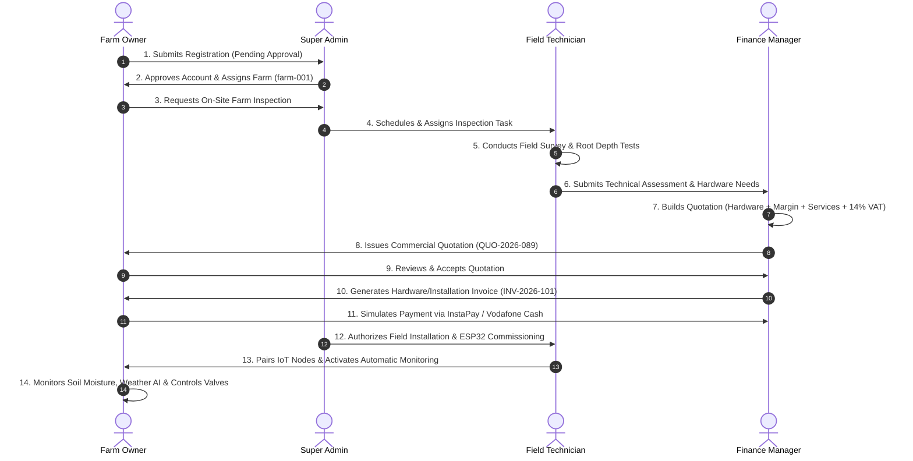

# Green Flow – End-to-End Business Operations Workflow

This document illustrates the complete operational lifecycle connecting Farmers, Field Technicians, the Finance Manager, and the Super Admin.

---

## 1. Lifecycle State Machines

### 1.1 Farmer Account Lifecycle
```
[Public Registration]
        │
        ▼
   PendingApproval ──(Admin Reject)──► Rejected
        │
   (Admin Approve)
        │
        ▼
     Approved ◄──► Suspended ──► Inactive
```

### 1.2 Field Inspection Request Lifecycle
```
[Farmer Request]
        │
        ▼
    Pending ──► Scheduled ──► InProgress
                                  │
                                  ▼
                         InspectionCompleted ──► QuotationPending ──► Approved
```

### 1.3 Commercial Quotation Lifecycle
```
[Finance Draft from Technical Assessment]
        │
        ▼
  PendingApproval ──► SentToFarmer
                           │
             ┌─────────────┴─────────────┐
             ▼                           ▼
          Accepted                    Rejected
             │
      (Auto-Generates Invoice)
```

### 1.4 Invoice & Payment Lifecycle
```
[Invoice Issued]
        │
        ▼
      Issued ──► PartiallyPaid ──► Paid (via Paymob/InstaPay/Fawry/Vodafone)
        │
    (Overdue)
        │
        ▼
     Overdue / Cancelled
```

---

## 2. Step-by-Step Workflow Scenario



---

## 3. Data Integrity & Sync Across Dashboards

1. **Shared Single Source of Truth**:
   All entities are governed by centralized singleton data sources:
   - `AuthService`: Manages accounts, sessions, and role credentials.
   - `FarmsMockDataSource`: Manages farms, zones, and inspection requests.
   - `FinanceMockDataSource`: Manages product catalogs, commercial quotations, and invoices.

2. **Reactive Notification & State Updates**:
   - When a farmer accepts a quotation, `FinanceMockDataSource.updateQuotationStatus()` automatically creates an associated `InvoiceEntity` and notifies all listeners.
   - When an invoice is paid, the status instantly reflects on both the Farmer's billing page and the Finance Manager's revenue metrics.
