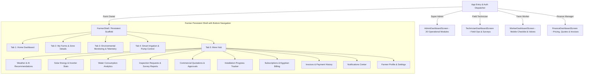

# Green Flow – Comprehensive Video & Codebase UX Audit Report

**Date:** November 2026  
**Auditor:** Senior Flutter Developer, Software Architect & Lead UI/UX Designer  
**Scope:** `D:\Projects\GreenFlow` (Mobile, Tablet & Desktop responsive Flutter application)

---

## 1. Executive Summary & Audit Context

A comprehensive audit was conducted across the Green Flow application source code and the Farmer user experience flow. The evaluation revealed that while individual technical features (Phase 1–12) were implemented, the application suffered from serious information architecture fragmentation, navigation discontinuities, role boundary leaks, and broken or non-reactive user actions.

This document details every identified defect, categorized by severity, along with the precise architectural resolution to be implemented.

---

## 2. Critical Identified Defects & UX Flaws

### 2.1 Navigation Architecture Defects (High Severity)
1. **Broken Bottom Navigation Persistence (Root Cause of UX Disorientation):**
   - The bottom navigation bar (`GreenFlowBottomNav`) was hosted exclusively inside `HomeScreen`.
   - As soon as the user navigated to *My Farms*, *Devices*, *Irrigation*, *Analytics*, or *Profile*, a standard `Navigator.pushNamed()` replaced the entire scaffold. The bottom navigation bar completely disappeared.
   - The user had to rely solely on the AppBar back button (`<--`), resulting in deep navigation stacks, lost context, and inability to jump between primary modules.
2. **Incorrect Tab Destinations in Bottom Navigation:**
   - The existing bar had: `Home`, `Farms`, `Devices`, `Analytics`, `Profile`.
   - `Devices` and `Analytics` are diagnostic tools rather than primary agricultural workflows.
   - As defined in the enterprise architecture, the 5 core Farmer destinations must be:
     1. **Home**
     2. **Farms**
     3. **Monitoring** (Sensors, Soil, Plant Health, Environment)
     4. **Irrigation** (Valves, Pumps, Schedules, Water Flow)
     5. **More** (Hub for Weather, Solar, Invoices, Quotations, Subscriptions, Inspections, Profile)
3. **Absence of Nested Navigation for Detail Pages:**
   - Opening a farm details page, device details, invoice preview, or inspection request created a fullscreen route that disconnected the user from the primary app shell.
4. **Android Back Button Behavior:**
   - Pressing Android back from a secondary tab abruptly exited the application rather than navigating back to the Home tab.

### 2.2 Role Boundary Leaks & Irrelevant Farmer Features (High Severity)
1. **Admin & Internal Enterprise Controls Visible to Farmers:**
   - In `ProfileScreen` (`_buildManagementCard`), a tile titled **"Admin Dashboard & Team / لوحة الإدارة وأعضاء الفريق"** was rendered for ordinary farmers.
   - Clicking it showed a red SnackBar: *"Access Denied: Current role (Farm Owner) cannot access Admin Dashboard"*.
   - **UX Rule Violation**: A user must *never* be shown administrative or restricted tools only to be told they cannot access them.
2. **Internal Financial Data Exposure:**
   - Farmers could inadvertently see internal pricing logic or lack clear separation between consumer quotations/invoices and company profit margins.
   - Product purchase costs and internal profit margins must be strictly quarantined within the **Finance Manager** workspace.
3. **Internal Hardware Inventory & Node Commissioning:**
   - Farmers were presented with raw hardware serial/MAC barcode commissioning tools that belong exclusively to the **Field Technician** and **Admin**.

### 2.3 Broken, Incomplete & Non-Reactive Actions (Medium-High Severity)
1. **Quotation Acceptance Non-Reactivity:**
   - In `InspectionDetailsScreen`, tapping **"قبول المقايسة المبدئية / Accept Quotation"** showed a transient SnackBar message but did *not* update the quotation status in `FinanceMockDataSource` and did *not* generate the corresponding installation invoice.
   - When the user navigated to Subscriptions or Invoices, the accepted quotation was absent.
2. **Missing Farm Ownership Data Filtering:**
   - In multiple widgets, sample data displayed hardcoded records for farms the farmer does not own.
   - Farmers must only see telemetry, devices, zones, and invoices belonging to their authenticated `assignedFarmId` or `assignedFarmIds`.
3. **Stubbed Action Handlers:**
   - Several secondary actions in previous widgets logged to debug console or presented placeholder dialogs with *"Feature unavailable"* or *"Contact Admin"*.

### 2.4 Dashboard Organization & Information Density (Medium Severity)
1. **Super Admin Dashboard Deficiencies:**
   - Previously consisted of only 3 basic tabs (KPIs, Pending Farmers, User Directory).
   - Lacked an actionable **"Action Required"** queue for overdue surveys, pending quotations, delayed installations, and urgent hardware shortages.
   - Lacked dedicated operational modules for Technician assignments, Hardware Inventory counts, and global Irrigation telemetry oversight.
2. **Technician Workspace Deficiencies:**
   - Previously only offered a basic list of inspections.
   - Lacked a structured **Technical Field Assessment Form** (soil depth sampling, water source verification, power availability, bill of materials selection).
   - Lacked step-by-step **Installation & Commissioning Checklists**.
3. **Farm Worker Workspace Deficiencies:**
   - Lacked mobile-first touch optimization for field workers operating in direct sunlight.
   - Lacked direct issue reporting (leaks, pump failures, pressure loss).
4. **Finance Manager Workspace Deficiencies:**
   - Lacked editable product SKU catalogs, minimum stock alerts, and automated 14% Egyptian VAT calculation during quotation drafting.

---

## 3. Systematic Architecture & Implementation Plan

To resolve all findings permanently, the following architecture is implemented:

---

## 4. Verification & Quality Gates

Each resolved phase will be validated against:
1. `flutter analyze --no-pub` ➔ Zero warnings, zero errors.
2. `flutter test --no-pub` ➔ 100% test pass rate across all 5 roles and navigation stacks.
3. RTL/LTR and Light/Dark visual integrity.
